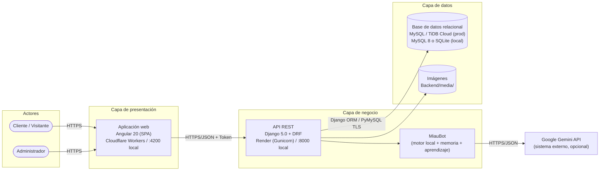

# Miau Market — Arquitectura del sistema

**Autores:** Juan Camilo Barragán Pottes · Angely Liced Herrera Roldán

Los diagramas detallados por nivel están en [modelo_c4.md](modelo_c4.md); el modelo de datos en [modelo_entidad_relacion.md](modelo_entidad_relacion.md) y las tecnologías en [stack_tecnologico.md](stack_tecnologico.md).

---

## 1. Estilo arquitectónico

Miau Market es una **aplicación web cliente-servidor en tres capas**, con el frontend y el backend **desacoplados** y comunicados por una **API REST**:

---

## 2. Elementos de la arquitectura

| Elemento | Tipo | Responsabilidad |
|----------|------|-----------------|
| **Cliente** | Actor | Explora el catálogo, gestiona favoritos y perfiles de mascotas, conversa con MiauBot, compra, cancela pedidos pendientes, sigue entregas y publica reseñas. |
| **Visitante** | Actor | Consulta el catálogo, detalle de producto y el chatbot sin memoria persistente; debe registrarse para comprar. |
| **Administrador** | Actor (`is_staff`) | Gestiona productos, categorías, usuarios, pedidos, dashboard analítico y aprendizaje del bot. |
| **Aplicación web** | Frontend (Angular 20) | Presentación, navegación protegida con guards (`authGuard`, `adminGuard`), interceptor HTTP 401, carrito en el navegador y token en `localStorage`. No decide precios ni stock. |
| **API REST** | Backend (Django + DRF) | Autenticación por token, permisos explícitos, limitación de tasa (*throttling*), validación de datos, reglas de negocio atómicas (stock con `select_for_update`, totales, caducidad, estados) y persistencia. |
| **MiauBot** | Módulo del backend | Detecta intención, busca productos activos del catálogo, utiliza la memoria del usuario y conocimiento aprobado; consulta a Gemini si hay clave configurada, con respaldo 100% local. |
| **Base de datos** | Persistencia relacional | Usuarios, catálogos (`cat_categoria`, `cat_metodo_pago`, `cat_estado_pedido`), productos, pedidos, reseñas, lista de deseos, mascotas, notificaciones y tablas de MiauBot con integridad referencial (FK reales). |
| **Almacén de imágenes** | Sistema de archivos | Imágenes de productos cargadas desde administración (`/media/productos/`). En el plan gratuito de Render el disco es efímero al redeploy. |
| **Google Gemini** | Sistema externo | Enriquece las respuestas conversacionales en lenguaje natural. Es opcional: sin clave o sin cuota, el bot opera con su motor local. |

No existe aplicación móvil nativa: la interfaz web es adaptable (*responsive*). No hay pasarela de pagos conectada en esta versión: los métodos de pago provienen de catálogo (con **contra entrega** como modalidad operativa sin pasarela).

---

## 3. Comunicación entre componentes

| Origen → destino | Protocolo / formato | Seguridad |
|------------------|---------------------|-----------|
| Navegador → Aplicación web | HTTPS | Certificado TLS gestionado por Cloudflare Workers. |
| Aplicación web → API | REST, JSON (y `multipart/form-data` para imágenes) | Encabezado `Authorization: Token <token>`; CORS restringido por `CORS_ALLOWED_ORIGINS` y `CSRF_TRUSTED_ORIGINS`; rate limit en login (`10/min`) y chatbot (`30/min`). |
| API → Base de datos | Django ORM sobre PyMySQL (SQL parametrizado) | Conexión cifrada TLS (`DB_SSL=True`) hacia TiDB Cloud; credenciales solo en variables de entorno. |
| API → Gemini | HTTPS, JSON | `GEMINI_API_KEY` solo en variables de entorno del servidor, nunca en el frontend. |

La URL del backend en el frontend se resuelve desde `EnvironmentService` (inyectada en build mediante `API_URL`); las imágenes mediante `EnvironmentService.getImageUrl()`.

### Servicios principales de la API (`/api/usuarios/...` y `/api/health/`)

| Grupo | Endpoints | Permiso |
|-------|-----------|---------|
| Salud | `/api/health/` | Público |
| Identidad y perfil | `registro/`, `login/`, `perfil/`, `<id>/` | Público (registro/login); propietario o admin (`perfil/`, `<id>/`) |
| Catálogos y tienda | `catalogos/`, `categorias/`, `productos/`, `productos/<id>/` | Lectura pública; escritura `IsAdminUser` |
| Favoritos y mascotas | `wishlist/`, `mascotas/`, `mascotas/<id>/` | `IsAuthenticated` (aislado por usuario) |
| Pedidos | `pedidos/`, `mis-pedidos/`, `pedidos/<id>/`, `pedidos/<id>/cancelar/` | `IsAuthenticated`; cambio de estado solo `IsAdminUser`; cancelación propia solo si está `Pendiente` |
| Reseñas | `productos/<id>/reviews/`, `my-review/`, `rating/`, `ratings/` | Lectura pública; escritura `IsAuthenticated` |
| Notificaciones | `notificaciones/`, `<id>/leer/`, `leer-todas/`, `verificar-caducados/` | `IsAuthenticated` |
| MiauBot | `chatbot/`, `chatbot/config/`, `gestion/miaubot/aprendizaje/` | Chat público con throttle; configuración y aprendizaje `IsAdminUser` |
| Administración | `usuarios/` (listado), `gestion/usuarios/...` | `IsAdminUser` |

---

## 4. Flujo de ejemplo: confirmar y cancelar un pedido

1. El cliente confirma en el checkout; Angular envía `POST /api/usuarios/pedidos/` con el token, los productos, método de pago del catálogo, dirección y teléfono.
2. DRF autentica el token y valida el cuerpo con `CrearPedidoSerializer`.
3. `pedidos_service.crear_pedido` abre una transacción (`@transaction.atomic`), bloquea los productos con `select_for_update()`, toma precios reales de la base de datos, valida stock, crea `PaymentOrders` y `Orders_Details`, y descuenta el inventario.
4. Se crean notificaciones para los administradores.
5. Si el cliente cancela (`POST /api/usuarios/pedidos/<id>/cancelar/` en estado `Pendiente`) o el administrador marca el pedido como `Devuelto` o `Cancelado`, el servicio restaura automáticamente el stock con bloqueo transaccional y notifica al cliente.

Este flujo corresponde al carril *Plataforma web* del [BPMN](BPMN.png).

---

## 5. Justificación de la arquitectura

| Decisión | Justificación |
|----------|---------------|
| **Frontend y backend separados (SPA + API REST)** | Cada capa evoluciona, se prueba y se despliega de forma independiente (Cloudflare Workers + Render); la misma API puede servir a futuros clientes sin reescribir la lógica de negocio. |
| **Reglas de negocio solo en el servidor** | El navegador no es confiable: precios, totales, stock atómico, caducidad y permisos se validan en Django, cumpliendo RN-01 a RN-04. |
| **Autenticación por token + guards + throttling** | Simplifica el consumo entre dominios distintos (Workers ↔ Render), protege rutas del cliente con guards/interceptor 401 y mitiga fuerza bruta/abuso en login y chatbot. |
| **Capa de servicios (`services/`)** | Mantiene vistas delgadas y concentra la lógica transaccional de pedidos, calificaciones y MiauBot para facilitar pruebas automatizadas. |
| **Base de datos relacional con catálogos y FK reales** | Pedidos, detalles, reseñas, favoritos, mascotas y catálogos (`cat_categoria`, `cat_metodo_pago`, `cat_estado_pedido`) garantizan integridad referencial. El ORM permite operar con MySQL/TiDB en producción y MySQL/SQLite en desarrollo. |
| **IA externa opcional con respaldo local** | MiauBot funciona sin conectividad o sin cuota de Gemini (RNF-11); el aprendizaje queda bajo aprobación administrativa (RN-09). |
| **Configuración por variables de entorno** | Secretos fuera del repositorio (RNF-03); el mismo código corre en local y en la nube sin cambios. |

---

## 6. Despliegue

| Entorno | Estado | Detalle |
|---------|--------|---------|
| **Producción (nube)** | **Activo** | Frontend Angular estático en Cloudflare Workers (`https://miau-market.juancamilobarragan2.workers.dev`), API Django con Gunicorn + WhiteNoise en Render (`https://miau-market-api.onrender.com`, health en `/api/health/`) y base de datos relacional MySQL-compatible en TiDB Cloud Starter con TLS. |
| **Local (desarrollo / demostración)** | **Activo** | `iniciar_miau_market.bat` levanta Django en `:8000` y Angular en `:4200`, compatible con MySQL 8 local o SQLite (`DB_ENGINE=sqlite`). |
