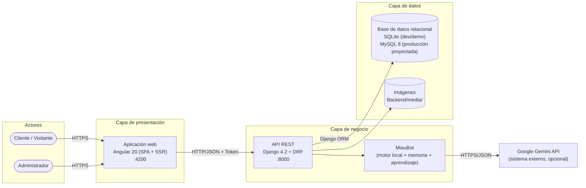

# Miau Market — Arquitectura del sistema

**Autores:** Juan Camilo Barragán Pottes · Angely Liced Herrera Roldán

Los diagramas detallados por nivel están en [modelo_c4.md](modelo_c4.md); el modelo de datos en [modelo_entidad_relacion.md](modelo_entidad_relacion.md) y las tecnologías en [stack_tecnologico.md](stack_tecnologico.md).

---

## 1. Estilo arquitectónico

Miau Market es una **aplicación web cliente-servidor en tres capas**, con el frontend y el backend **desacoplados** y comunicados por una **API REST**:

---

## 2. Elementos de la arquitectura

| Elemento | Tipo | Responsabilidad |
|----------|------|-----------------|
| **Cliente** | Actor | Explora el catálogo, conversa con MiauBot, compra, sigue pedidos y publica reseñas. |
| **Visitante** | Actor | Consulta el catálogo y el chatbot sin memoria persistente; debe registrarse para comprar. |
| **Administrador** | Actor (`is_staff`) | Gestiona productos, categorías, usuarios, pedidos, dashboard y aprendizaje del bot. |
| **Aplicación web** | Frontend (Angular) | Presentación, navegación, carrito en el navegador, token de sesión en `localStorage`. No decide precios ni stock. |
| **API REST** | Backend (Django + DRF) | Autenticación por token, permisos, validación de datos, reglas de negocio (stock, total, caducidad, estados) y persistencia. |
| **MiauBot** | Módulo del backend | Detecta intención, busca productos del catálogo, usa la memoria del usuario y el conocimiento aprobado; consulta a Gemini si está configurado. |
| **Base de datos** | Persistencia | Usuarios, categorías, productos, pedidos, reseñas, notificaciones y datos de MiauBot con integridad referencial (FK). |
| **Almacén de imágenes** | Sistema de archivos | Imágenes de productos subidas desde administración (`/media/productos/`). |
| **Google Gemini** | Sistema externo | Genera respuestas en lenguaje natural. Es opcional: sin clave, el bot responde con su motor local. |

No hay aplicación móvil nativa: la aplicación web es adaptable (responsive). No hay pasarela de pagos: el pago es contra entrega.

---

## 3. Comunicación entre componentes

| Origen → destino | Protocolo / formato | Seguridad |
|------------------|---------------------|-----------|
| Navegador → Aplicación web | HTTP(S) | — |
| Aplicación web → API | REST, JSON (y `multipart/form-data` para imágenes) | Encabezado `Authorization: Token <token>`; CORS limitado por `CORS_ALLOWED_ORIGINS`. |
| API → Base de datos | Django ORM (SQL parametrizado) | Credenciales y ruta por variables de entorno. |
| API → Gemini | HTTPS, JSON | `GEMINI_API_KEY` solo en `Backend/.env`, nunca en el frontend. |

La URL del backend en el frontend se obtiene de `EnvironmentService`; las imágenes con `EnvironmentService.getImageUrl()`.

### Servicios principales de la API (`/api/usuarios/...`)

| Grupo | Endpoints | Permiso |
|-------|-----------|---------|
| Identidad | `registro/`, `login/`, `perfil/` | Público / autenticado |
| Catálogo | `categorias/`, `productos/`, `productos/<id>/` | Lectura pública; escritura `IsAdminUser` |
| Pedidos | `pedidos/`, `mis-pedidos/`, `pedidos/<id>/` | Autenticado; cambio de estado solo admin |
| Reseñas | `productos/<id>/reviews/`, `my-review/`, `rating/`, `ratings/` | Lectura pública; escritura autenticado |
| Notificaciones | `notificaciones/`, `<id>/leer/`, `leer-todas/`, `verificar-caducados/` | Autenticado |
| MiauBot | `chatbot/`, `chatbot/config/`, `gestion/miaubot/aprendizaje/` | Chat público; configuración y aprendizaje admin |
| Administración | `gestion/usuarios/...` | `IsAdminUser` |

---

## 4. Flujo de ejemplo: confirmar un pedido

1. El cliente confirma en el checkout; Angular envía `POST /api/usuarios/pedidos/` con el token, los productos, dirección y teléfono.
2. DRF autentica el token y valida el cuerpo con `CrearPedidoSerializer`.
3. `pedidos_service.crear_pedido` abre una transacción: toma el precio de la base de datos, valida stock, crea `PaymentOrders` y `Orders_Details`, y descuenta el stock.
4. Se crean notificaciones para los administradores.
5. La API responde `201` con el pedido; si falta stock responde `400` con un mensaje claro y no se guarda nada.

Este flujo corresponde al carril *Plataforma web* del [BPMN](BPMN.png).

---

## 5. Justificación de la arquitectura

| Decisión | Justificación |
|----------|---------------|
| **Frontend y backend separados (SPA + API REST)** | Cada capa evoluciona y se prueba por separado; la misma API puede servir a otro cliente (por ejemplo una app móvil futura) sin cambiar el backend. |
| **Reglas de negocio solo en el servidor** | El navegador no es confiable: precios, totales, stock, caducidad y permisos se validan en Django, cumpliendo RN-01 a RN-04. |
| **Autenticación por token** | Es simple de usar desde una SPA, no depende de cookies de sesión entre puertos distintos y permite revocar el acceso borrando el token. |
| **Capa de servicios (`services/`)** | Las vistas quedan delgadas; la lógica de pedidos, calificaciones y MiauBot es reutilizable y verificable. |
| **Base de datos relacional con FK reales** | Pedidos, detalles, reseñas y categorías requieren integridad referencial y transacciones. El ORM permite pasar de SQLite a MySQL cambiando solo la configuración. |
| **Catálogos en tablas (`Categories`)** | Las categorías se administran sin modificar código y la tienda las muestra dinámicamente. |
| **IA externa opcional con respaldo local** | MiauBot sigue funcionando sin conectividad o sin cuota de Gemini (RNF-11); el aprendizaje queda bajo aprobación del administrador (RN-09). |
| **Configuración por variables de entorno** | Secretos fuera del repositorio (RNF-03); el mismo código sirve en desarrollo y producción. |

---

## 6. Despliegue

| Entorno | Estado | Detalle |
|---------|--------|---------|
| Local (desarrollo / demostración) | **Activo** | `iniciar_miau_market.bat` levanta Django en `:8000` y Angular en `:4200` con `Backend/db.sqlite3`. |
| Producción | **Proyectado** | Angular compilado servido como estático, Django con Gunicorn detrás de un proxy HTTPS, MySQL 8 y `DJANGO_DEBUG=False`. |
