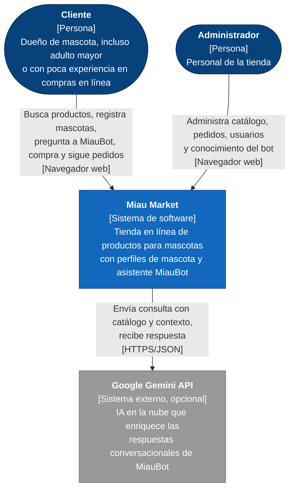
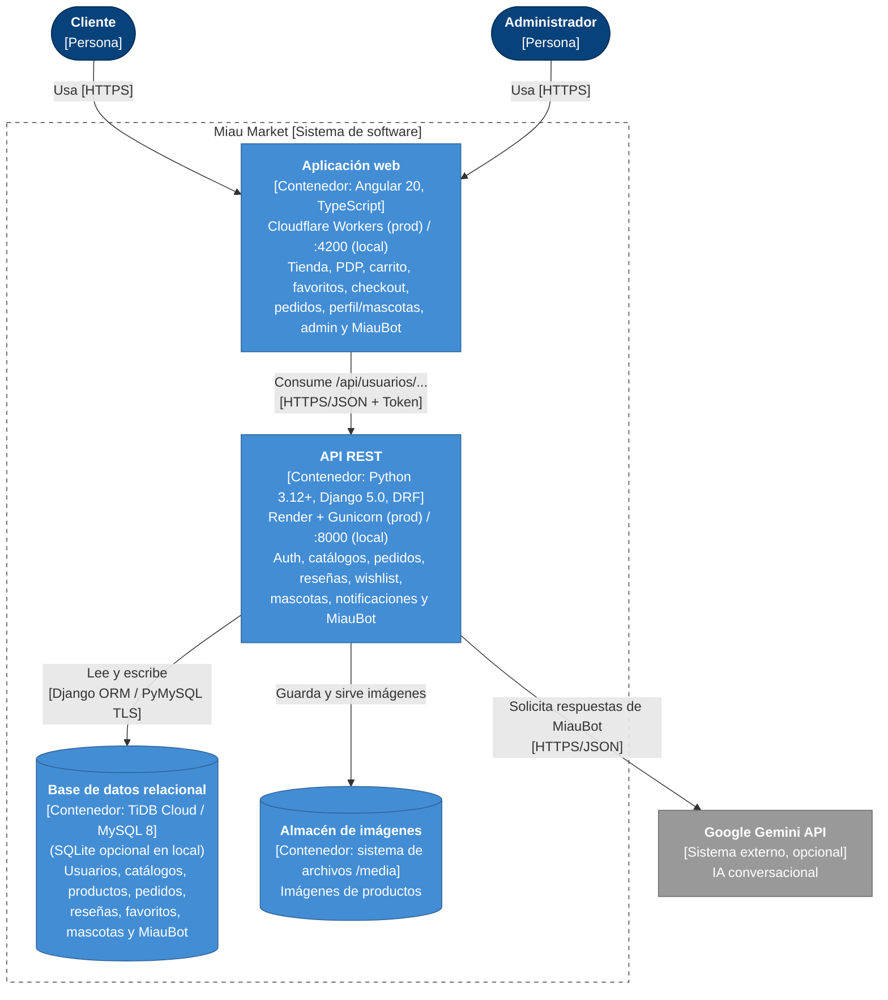
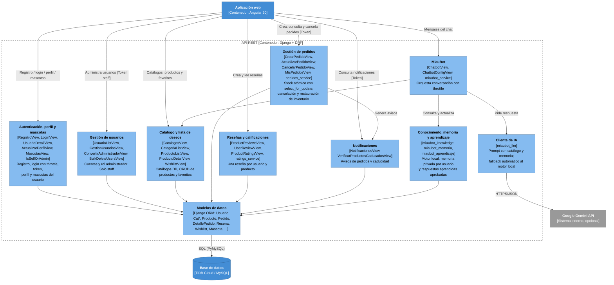

# Miau Market — Modelo C4

**Proyecto:** Miau Market — tienda en línea de productos para mascotas con asistente virtual (MiauBot).
**Autores:** Juan Camilo Barragán Pottes · Angely Liced Herrera Roldán

El modelo describe la arquitectura en cuatro niveles. Cada nivel amplía un elemento del nivel anterior:

| Nivel | Elemento que se amplía | Qué muestra |
|-------|------------------------|-------------|
| 1. Contexto | — | El sistema Miau Market, sus usuarios y los sistemas externos. |
| 2. Contenedores | Sistema *Miau Market* | Aplicación web, API REST, base de datos relacional y almacén de imágenes. |
| 3. Componentes | Contenedor *API REST* | Módulos internos del backend y su responsabilidad. |
| 4. Código | Componente *Gestión de pedidos* | Clases, servicio transaccional y modelos que implementan pedidos y catálogos. |

---

## Nivel 1 — Contexto

**Elementos:**

- **Cliente:** usuario final; actor principal del proceso de compra.
- **Administrador:** usuario con permiso de personal (`is_staff`). Opera el panel de administración y el dashboard.
- **Miau Market:** sistema web desarrollado y desplegado.
- **Google Gemini API:** sistema externo opcional. Si no está disponible o no hay clave configurada, MiauBot responde con su motor local y la base de conocimiento/aprendizaje aprobada.

No existe integración con pasarela de pagos en esta versión; el método operativo principal es **contra entrega**.

---

## Nivel 2 — Contenedores

| Contenedor | Tecnología | Responsabilidad |
|------------|-----------|-----------------|
| Aplicación web | Angular 20 (componentes standalone, signals, guards, interceptor 401) en Cloudflare Workers | Presentación, navegación, carrito y sesión (`localStorage`). No contiene reglas de negocio críticas. |
| API REST | Django 5.0 + DRF + Gunicorn + WhiteNoise en Render | Valida datos, precios y stock; aplica permisos (`IsAuthenticated`, `IsAdminUser`, `IsSelfOrAdmin`), throttling y orquesta MiauBot. |
| Base de datos | TiDB Cloud Starter (MySQL-compatible, TLS) en producción; MySQL 8 o SQLite en local | Persistencia relacional con integridad referencial (FK) para todas las entidades y catálogos. |
| Almacén de imágenes | Carpeta `Backend/media/productos/` | Archivos de imagen referenciados desde `Products`. |

No se desarrolla aplicación móvil nativa: la aplicación web es adaptable (*responsive*).

---

## Nivel 3 — Componentes del contenedor *API REST*

| Componente | Archivos | Responsabilidad |
|------------|----------|-----------------|
| Autenticación, perfil y mascotas | `views.py`, `permissions.py`, `login_serializer.py`, `backends.py` | Registro, login con throttle, token, aislamiento de usuario (`IsSelfOrAdmin`), perfil y mascotas. |
| Gestión de usuarios | `views.py` (`UsuarioListView`, `Gestion*`, `Bulk*`) | Administración de cuentas y roles. Requiere `IsAdminUser`. |
| Catálogo y lista de deseos | `views.py`, `serializers.py` | Catálogos (`cat_categoria`, `cat_metodo_pago`, `cat_estado_pedido`), CRUD de productos y favoritos (`Lista_Deseos`). |
| Gestión de pedidos | `views.py`, `pedidos_serializers.py`, `services/pedidos_service.py` | Pedido transaccional, bloqueo de stock, cancelación del cliente y restauración automática. |
| Reseñas y calificaciones | `views.py`, `reviews_serializers.py`, `services/ratings_service.py` | Reseñas y promedio por producto. |
| Notificaciones | `views.py`, `notificaciones_serializers.py` | Avisos al cliente y al administrador. |
| MiauBot | `ai_views.py`, `services/miaubot_service.py` | Orquestación del asistente y configuración administrativa. |
| Conocimiento, memoria y aprendizaje | `services/miaubot_knowledge.py`, `miaubot_memoria.py`, `miaubot_aprendizaje.py` | Motor local, memoria persistente y flujo de aprobación de respuestas. |
| Cliente de IA | `services/miaubot_llm.py` | Integración opcional con Google Gemini. |
| Modelos de datos | `models.py` | Entidades, catálogos y relaciones FK. |

---

## Nivel 4 — Código del componente *Gestión de pedidos*

```mermaid
classDiagram
  direction LR

  class CrearPedidoView {
    <<APIView>>
    +permission_classes: IsAuthenticated
    +post(request) Response
  }
  class ActualizarPedidoView {
    <<APIView>>
    +permission_classes: IsAuthenticated, IsAdminUser
    +put(request, pk) Response
  }
  class CancelarPedidoView {
    <<APIView>>
    +permission_classes: IsAuthenticated
    +post(request, pk) Response
  }
  class MisPedidosView {
    <<APIView>>
    +permission_classes: IsAuthenticated
    +get(request) Response
  }
  class CrearPedidoSerializer {
    <<Serializer>>
    +Metodo_Pago: str
    +productos: DetallePedidoSerializer[]
    +direccion_envio: str
    +telefono_envio: str
  }
  class DetallePedidoSerializer {
    <<Serializer>>
    +Id_Products: int
    +Cantidad: int
    +Precio_Unitario: Decimal
  }
  class pedidos_service {
    <<módulo de servicio>>
    +crear_pedido(usuario, data) Pedido
    +actualizar_estado_pedido(pedido_id, nuevo_estado) Pedido
    +cancelar_pedido_usuario(pedido_id, usuario_id) Pedido
    +listar_pedidos_usuario(usuario_id) list
    +listar_pedidos_admin() list
    -_restaurar_stock(pedido)
    -_notificar_admins(pedido)
  }
  class Pedido {
    <<Model: PaymentOrders>>
    +id: int
    +Fecha: datetime
    +Total: Decimal
    +Metodo_Pago: str
    +metodo_pago: CatMetodoPago
    +Estado: str
    +estado: CatEstadoPedido
    +Direccion_Envio: str
    +Telefono_Envio: str
  }
  class CatMetodoPago {
    <<Model: cat_metodo_pago>>
    +codigo: str
    +nombre: str
    +requiere_pasarela: bool
    +activo: bool
  }
  class CatEstadoPedido {
    <<Model: cat_estado_pedido>>
    +codigo: str
    +nombre: str
    +restaura_stock: bool
    +activo: bool
  }
  class DetallePedido {
    <<Model: Orders_Details>>
    +Cantidad: int
    +Precio_Unitario: Decimal
    +Subtotal: Decimal
  }
  class Producto {
    <<Model: Products>>
    +Titulo: str
    +Precio: int
    +Stock: int
    +Fecha_Caducidad: date
  }
  class CatCategoria {
    <<Model: cat_categoria>>
    +codigo: str
    +nombre: str
    +animal: str
    +tema: str
    +perecedero: bool
    +activo: bool
  }
  class Usuario {
    <<Model: Users>>
    +Email: str
    +Username: str
    +Nombre: str
    +is_staff: bool
  }
  class Notificacion {
    <<Model: Notificaciones>>
    +Titulo: str
    +Mensaje: str
    +Tipo: str
    +Leida: bool
  }

  CrearPedidoView ..> CrearPedidoSerializer : valida con
  CrearPedidoSerializer *-- DetallePedidoSerializer : productos
  CrearPedidoView ..> pedidos_service : crear_pedido()
  ActualizarPedidoView ..> pedidos_service : actualizar_estado_pedido()
  CancelarPedidoView ..> pedidos_service : cancelar_pedido_usuario()
  MisPedidosView ..> pedidos_service : listar_pedidos_usuario()
  pedidos_service ..> Pedido : crea / actualiza
  pedidos_service ..> DetallePedido : crea
  pedidos_service ..> Producto : bloquea y actualiza Stock
  pedidos_service ..> Notificacion : crea avisos
  Usuario "1" --> "*" Pedido : realiza
  Pedido "*" --> "1" CatMetodoPago : metodo_pago
  Pedido "*" --> "1" CatEstadoPedido : estado
  Pedido "1" *-- "1..*" DetallePedido : contiene
  DetallePedido "*" --> "1" Producto : referencia
  Producto "*" --> "1" CatCategoria : pertenece a
  Notificacion "*" --> "1" Usuario : destinatario
  Notificacion "*" --> "0..1" Pedido : sobre
```

**Reglas implementadas en este nivel:**

1. `crear_pedido` se ejecuta dentro de `@transaction.atomic` y bloquea los productos con `select_for_update()`: si un producto no existe o no tiene stock suficiente, la transacción se revierte por completo.
2. El precio se toma de la base de datos (nunca del navegador), el método de pago y estado se resuelven contra `cat_metodo_pago` y `cat_estado_pedido`, y el total lo calcula el servidor.
3. Al crear el pedido se descuenta el stock y se notifica a los administradores.
4. `actualizar_estado_pedido` valida estados del catálogo (`Pendiente`, `Enviado`, `Entregado`, `Devuelto`, `Cancelado`); cuando transiciona a un estado con `restaura_stock=True` (`Devuelto` o `Cancelado`) sin haber restaurado previamente, reintegra el inventario y notifica al cliente.
5. `cancelar_pedido_usuario` permite al propietario cancelar únicamente pedidos en estado `Pendiente`, delegando en `actualizar_estado_pedido(..., 'cancelado')`.
