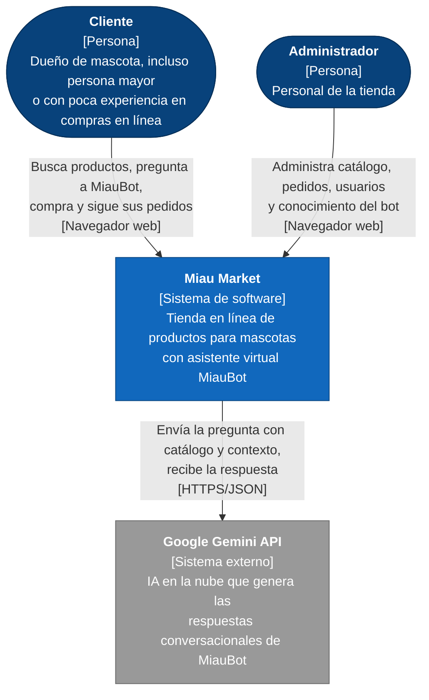
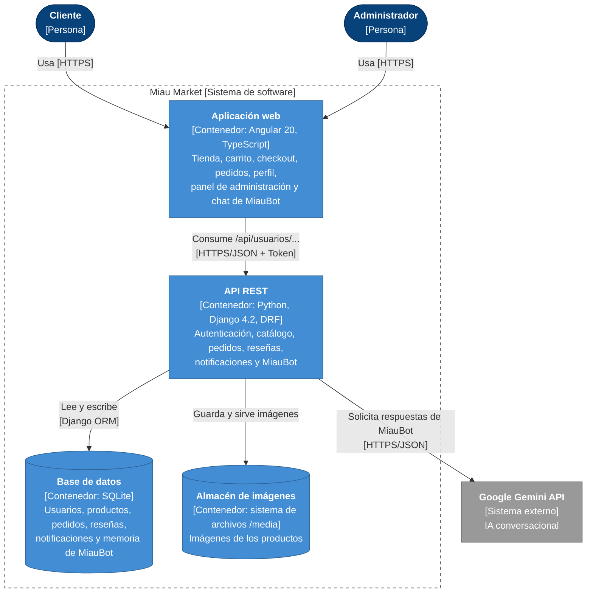
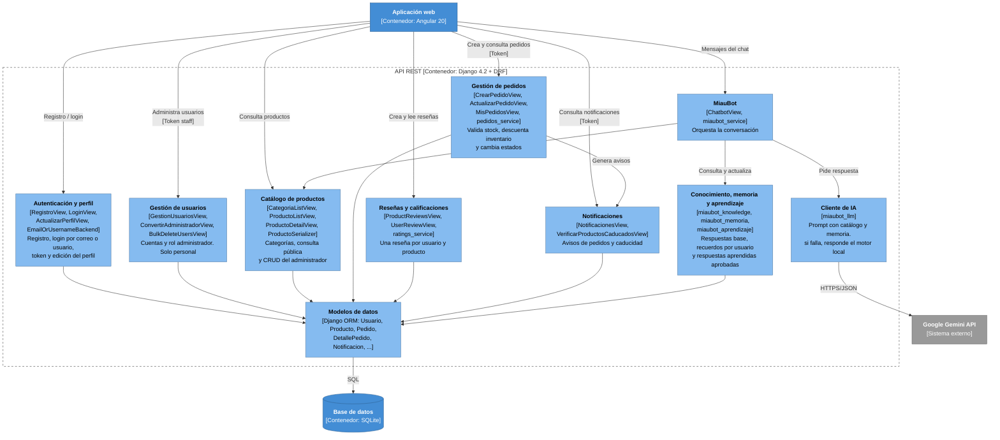

# Miau Market — Modelo C4

**Proyecto:** Miau Market — tienda en línea de productos para mascotas con asistente virtual (MiauBot).
**Autores:** Juan Camilo Barragán Pottes · Angely Liced Herrera Roldán

El modelo describe la arquitectura en cuatro niveles. Cada nivel amplía un elemento del nivel anterior:

| Nivel | Elemento que se amplía | Qué muestra |
|-------|------------------------|-------------|
| 1. Contexto | — | El sistema Miau Market, sus usuarios y los sistemas externos. |
| 2. Contenedores | Sistema *Miau Market* | Aplicación web, API, base de datos y almacén de imágenes. |
| 3. Componentes | Contenedor *API REST* | Módulos internos del backend y su responsabilidad. |
| 4. Código | Componente *Gestión de pedidos* | Clases, servicio y modelos que implementan el pedido. |

---

## Nivel 1 — Contexto

**Elementos:**

- **Cliente:** usuario final; actor principal del proceso de compra
- **Administrador:** usuario con permiso de personal (`is_staff`). Opera el panel de administración.
- **Miau Market:** el sistema que se desarrolla.
- **Google Gemini API:** sistema externo. Si no está disponible o no hay clave configurada, MiauBot responde con su motor local, por lo que el sistema sigue funcionando.

El pago es **contra entrega**, por lo que no existe integración con pasarela de pagos.

---

## Nivel 2 — Contenedores

| Contenedor | Tecnología | Responsabilidad |
|------------|-----------|-----------------|
| Aplicación web | Angular 20 (componentes standalone, signals) | Presentación. Guarda el token de sesión y el carrito en el navegador. No contiene reglas de negocio críticas. |
| API REST | Django 4.2 + DRF, autenticación por token | Valida datos, precios y stock; aplica permisos (`IsAuthenticated`, `IsAdminUser`); orquesta MiauBot. |
| Base de datos | SQLite (`Backend/db.sqlite3`) en desarrollo y demostración; MySQL 8 proyectado para producción | Persistencia de todas las entidades del negocio. |
| Almacén de imágenes | Carpeta `Backend/media/productos/` | Archivos de imagen referenciados desde la tabla de productos. |

No se desarrolla aplicación móvil: la aplicación web es adaptable (responsive) y se usa desde el navegador del celular.

---

## Nivel 3 — Componentes del contenedor *API REST*

| Componente | Archivos | Responsabilidad |
|------------|----------|-----------------|
| Autenticación y perfil | `views.py`, `login_serializer.py`, `backends.py` | Registro, login por correo o usuario, token, perfil. |
| Gestión de usuarios | `views.py` (vistas `Gestion*`, `Bulk*`) | Administración de cuentas y roles. Requiere `IsAdminUser`. |
| Catálogo de productos | `views.py`, `serializers.py` | Catálogo de categorías (tabla `Categories`) y CRUD de productos; lectura pública. |
| Gestión de pedidos | `views.py`, `pedidos_serializers.py`, `services/pedidos_service.py` | Pedido transaccional con validación de stock. |
| Reseñas y calificaciones | `views.py`, `reviews_serializers.py`, `services/ratings_service.py` | Reseñas y promedio por producto. |
| Notificaciones | `views.py`, `notificaciones_serializers.py` | Avisos al cliente y al administrador. |
| MiauBot | `ai_views.py`, `services/miaubot_service.py` | Orquestación del asistente. |
| Conocimiento, memoria y aprendizaje | `services/miaubot_knowledge.py`, `miaubot_memoria.py`, `miaubot_aprendizaje.py` | Datos que hacen al bot personalizado y paciente. |
| Cliente de IA | `services/miaubot_llm.py` | Integración con Google Gemini. |
| Modelos de datos | `models.py` | Entidades y tablas. |

---

## Nivel 4 — Código del componente *Gestión de pedidos*

```mermaid
classDiagram
  direction LR

  class CrearPedidoView {
    <<APIView>>
    +permission_classes: IsAuthenticated
    +post(request) Response
  }
  class ActualizarPedidoView {
    <<APIView>>
    +permission_classes: IsAuthenticated, IsAdminUser
    +put(request, pk) Response
  }
  class MisPedidosView {
    <<APIView>>
    +get(request) Response
  }
  class CrearPedidoSerializer {
    <<Serializer>>
    +Metodo_Pago: str
    +productos: DetallePedidoSerializer[]
    +direccion_envio: str
    +telefono_envio: str
  }
  class DetallePedidoSerializer {
    <<Serializer>>
    +Id_Products: int
    +Cantidad: int
    +Precio_Unitario: Decimal
  }
  class pedidos_service {
    <<módulo de servicio>>
    +crear_pedido(usuario, data) Pedido
    +actualizar_estado_pedido(pedido_id, nuevo_estado) Pedido
    +listar_pedidos_usuario(usuario_id) list
    +listar_pedidos_admin() list
    -_notificar_admins(pedido)
    -_limpiar_notificaciones(usuario_id, limite)
  }
  class Pedido {
    <<Model: PaymentOrders>>
    +id: int
    +Fecha: datetime
    +Total: Decimal
    +Metodo_Pago: str
    +Estado: Pendiente|Enviado|Entregado|Devuelto
    +Direccion_Envio: str
    +Telefono_Envio: str
  }
  class DetallePedido {
    <<Model: Orders_Details>>
    +Cantidad: int
    +Precio_Unitario: Decimal
    +Subtotal: Decimal
  }
  class Producto {
    <<Model: Products>>
    +Titulo: str
    +Precio: int
    +Stock: int
    +Fecha_Caducidad: date
  }
  class Categoria {
    <<Model: Categories>>
    +Codigo: str
    +Nombre: str
    +Perecedero: bool
    +Activo: bool
  }
  class Usuario {
    <<Model: Users>>
    +Email: str
    +Nombre: str
    +is_staff: bool
  }
  class Notificacion {
    <<Model: Notificaciones>>
    +Titulo: str
    +Mensaje: str
    +Tipo: str
    +Leida: bool
  }

  CrearPedidoView ..> CrearPedidoSerializer : valida con
  CrearPedidoSerializer *-- DetallePedidoSerializer : productos
  CrearPedidoView ..> pedidos_service : crear_pedido()
  ActualizarPedidoView ..> pedidos_service : actualizar_estado_pedido()
  MisPedidosView ..> pedidos_service : listar_pedidos_usuario()
  pedidos_service ..> Pedido : crea / actualiza
  pedidos_service ..> DetallePedido : crea
  pedidos_service ..> Producto : valida y descuenta Stock
  pedidos_service ..> Notificacion : crea avisos
  Usuario "1" --> "*" Pedido : realiza
  Pedido "1" *-- "1..*" DetallePedido : contiene
  DetallePedido "*" --> "1" Producto : referencia
  Producto "*" --> "1" Categoria : pertenece a
  Notificacion "*" --> "1" Usuario : destinatario
  Notificacion "*" --> "0..1" Pedido : sobre
```

**Reglas implementadas en este nivel:**

1. `crear_pedido` se ejecuta dentro de una transacción (`@transaction.atomic`): si un producto no existe o no tiene stock suficiente, no se guarda nada.
2. El precio se toma de la base de datos, no del navegador, y el total lo calcula el servidor.
3. Al crear el pedido se descuenta el stock y se notifica a todos los administradores.
4. `actualizar_estado_pedido` solo acepta los estados `Pendiente`, `Enviado`, `Entregado` y `Devuelto`, y crea una notificación para el cliente.

---

