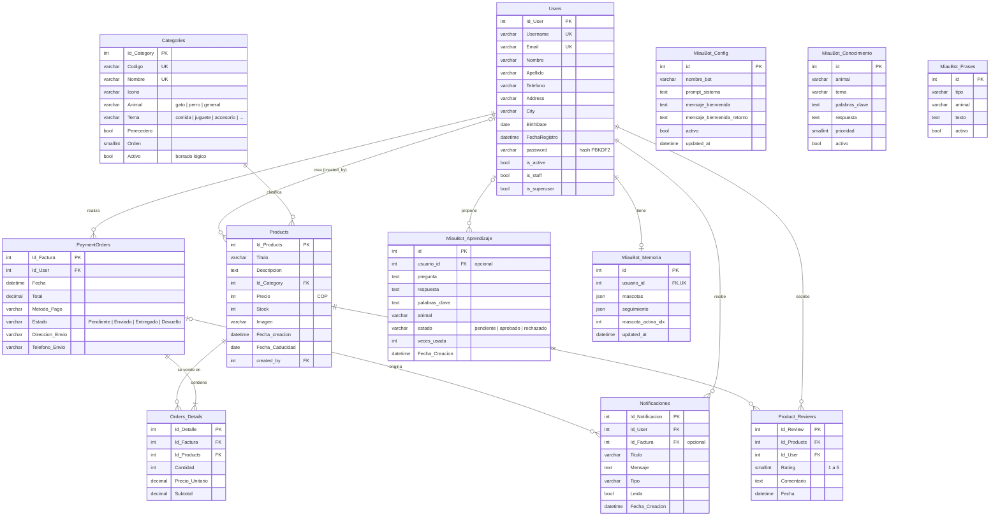

# Miau Market — Modelo entidad-relación (MER)

**Autores:** Juan Camilo Barragán Pottes · Angely Liced Herrera Roldán

El modelo muestra solo las **tablas de negocio**. Las tablas internas de Django (`auth_*`, `django_*`, `authtoken_token`, `Users_groups`, `Users_user_permissions`) no forman parte del dominio y se omiten.

El esquema se crea con las migraciones de Django (`Backend/usuarios/migrations/`) y es idéntico en SQLite (desarrollo/demostración) y MySQL 8 (`utf8mb4_unicode_ci`). El archivo de Workbench es `DIAGRAMA MODELO ENTIDAD.mwb` y su imagen `MER.png`.

---

## 1. Diagrama

`MiauBot_Config`, `MiauBot_Conocimiento` y `MiauBot_Frases` son tablas de configuración del asistente sin relación con otras entidades.

---

## 2. Relaciones y cardinalidades

| Relación | Cardinalidad | FK | Al borrar el padre |
|----------|--------------|----|--------------------|
| Users → PaymentOrders | 1 : N | `PaymentOrders.Id_User` | Se borran sus pedidos |
| PaymentOrders → Orders_Details | 1 : N (mínimo 1) | `Orders_Details.Id_Factura` | Se borran los detalles |
| Products → Orders_Details | 1 : N | `Orders_Details.Id_Products` | Se borran los detalles |
| Categories → Products | 1 : N | `Products.Id_Category` (obligatoria) | **Prohibido** si tiene productos (`PROTECT`); se desactiva con `Activo` |
| Users → Products | 0..1 : N | `Products.created_by` | Queda en `NULL` |
| Users → Product_Reviews | 1 : N | `Product_Reviews.Id_User` | Se borran sus reseñas |
| Products → Product_Reviews | 1 : N | `Product_Reviews.Id_Products` | Se borran las reseñas |
| Users → Notificaciones | 1 : N | `Notificaciones.Id_User` | Se borran sus notificaciones |
| PaymentOrders → Notificaciones | 0..1 : N | `Notificaciones.Id_Factura` | Queda en `NULL` |
| Users → MiauBot_Aprendizaje | 0..1 : N | `MiauBot_Aprendizaje.usuario_id` | Queda en `NULL` (se conserva el conocimiento) |
| Users → MiauBot_Memoria | 1 : 0..1 | `MiauBot_Memoria.usuario_id` (única) | Se borra la memoria |

---

## 3. Restricciones

| Restricción | Tabla | Regla de negocio |
|-------------|-------|------------------|
| `Email` y `Username` únicos | Users | Una cuenta por correo (RF-01). |
| `Codigo` y `Nombre` únicos | Categories | Catálogo sin duplicados (RF-06). |
| `uk_reviews_user_product` (`Id_User`, `Id_Products`) | Product_Reviews | Una reseña por usuario y producto (RN-08). |
| `Rating` entre 1 y 5 | Product_Reviews | Validado en el modelo y el serializador (RF-15). |
| `usuario_id` único | MiauBot_Memoria | Memoria privada por usuario (RN-10). |
| `Estado` ∈ `Pedido.ESTADOS` | PaymentOrders | Validado en `ActualizarPedidoView` (RF-25). |
| `Stock` suficiente y precio tomado de BD | Orders_Details | Validado en `pedidos_service.crear_pedido` dentro de una transacción (RN-01, RN-02). |
| Edad 18 a 120 años | Users (`BirthDate`) | Validado en el registro y en la edición del perfil (RN-07). |

---

## 4. Vista

**`Product_Ratings`**: por cada producto calcula `Total_Reviews`, `Rating_Promedio` y el conteo por estrellas (`Reviews_5_Estrellas` … `Reviews_1_Estrella`) a partir de `Products LEFT JOIN Product_Reviews`. La usa `ratings_service` para mostrar el promedio (RF-16).
